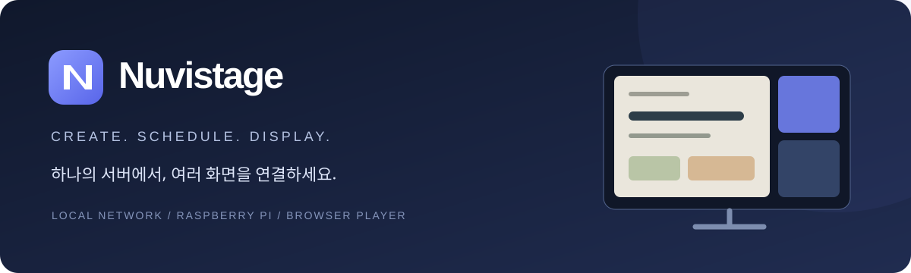
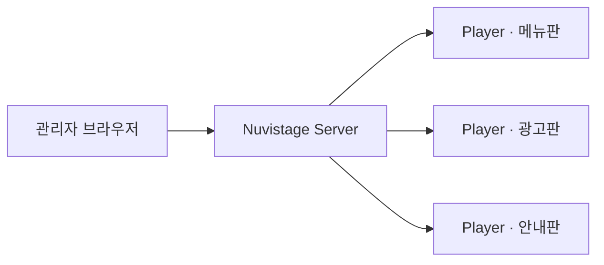

<div align="center">



**로컬 네트워크를 위한 디지털 사이니지 스튜디오**

콘텐츠 제작부터 장치 연결, 예약 재생, 그룹 배포까지 한곳에서 관리합니다.

`v0.9` · `Python + JavaScript` · `Raspberry Pi / macOS` · `Local-first`

[빠른 시작](#빠른-시작) · [주요 기능](#주요-기능) · [Player 연결](DEVICE_REGISTRATION.md) · [배포 안내](DEPLOYMENT.md) · [개발 안내](DEVELOPMENT.md)

</div>

---

## Nuvistage는

한 대의 메인 서버에서 여러 디스플레이의 콘텐츠를 관리하는 사이니지 시스템입니다. 관리자 페이지는 브라우저에서 열고, 각 Player는 서버에서 내려받은 콘텐츠를 출력합니다. 추가 Player에서 관리 서버를 실행할 필요가 없습니다.



## 주요 기능

| 영역 | 지원 기능 |
| --- | --- |
| **콘텐츠 편집** | 자유 편집, 이미지·영상 반복, 슬라이드, 레이어 애니메이션 |
| **디자인 도구** | 도형 14종, 다중 선택·정렬, 회전·그림자, 잠금·숨김, 격자·확대 |
| **템플릿** | 한국어 기본 디자인 31종, 내 템플릿 제작·수정, JSON 가져오기·내보내기 |
| **글꼴·미디어** | 한국어 글꼴 17종, 외부 글꼴 등록, 이미지·영상 업로드, 사용 중인 파일 삭제 보호 |
| **장치 연결** | 고정 16자리 코드, 화면 배정, 자동 재연결, 차단·토큰 폐기 |
| **송출 운영** | 재생목록, 장치 그룹, 시간표, 배포 버전, 최대 6분할, 임시 안내 |
| **오프라인** | 배포된 콘텐츠·글꼴·시간표를 Player에 캐시하여 재생 |
| **운영 기록** | 연결 상태, 배포 수신 버전, 저장 공간, 프로세스 가동 시간, CSV |

## 빠른 시작

### 1. 설치

Python 3.11 이상과 최신 Chromium 계열 브라우저를 준비합니다. 아래 명령은 macOS 또는 Linux 터미널 기준입니다.

```bash
git clone https://github.com/leesangmin0802/Nuvistage-Beta nuvistage
cd nuvistage
python3 -m venv .venv
.venv/bin/python -m pip install -r requirements.txt
```

### 2. 서버 시작

```bash
.venv/bin/python server.py
```

[http://localhost:8765](http://localhost:8765)를 열고 **처음 사용할 관리자 계정**을 만듭니다. 비밀번호는 12자 이상으로 설정합니다. 기본 아이디·기본 비밀번호는 없으며 최초 계정 생성은 서버의 localhost에서만 허용됩니다.

> 저장소에는 계정, 등록 장치, 운영 콘텐츠가 들어 있지 않습니다. 실행하면 필요한 데이터 파일을 새로 생성합니다. `data.example.json`은 빈 데이터 구조를 보여주는 예제입니다.

### 3. 첫 콘텐츠 만들기

1. **출력 화면 → 새 디스플레이**에서 이름과 화면 종류를 정합니다.
2. 자유 편집으로 제작하거나 템플릿을 선택합니다.
3. **저장 및 적용** 후 대시보드에서 확인합니다.
4. 실제 디스플레이를 연결하려면 [Player 연결 안내](DEVICE_REGISTRATION.md)를 진행합니다.

## 운영 흐름

```text
미디어 · 템플릿 → 콘텐츠 제작 → 재생목록 → 장치 그룹 · 시간표 → 배포
```

- **직접 화면 배정:** 그룹이 없는 Player에는 지정한 출력 화면을 재생합니다.
- **그룹 운영:** 초안 저장과 실제 송출을 구분합니다. 그룹에서 **배포**를 눌러야 변경 내용을 전달합니다.
- **예약 재생:** 요일·시간·날짜·시간대·우선순위를 지정합니다. 예약이 없으면 기본 재생목록을 사용합니다.
- **임시 출력:** 지정한 시간 동안 문구나 재생목록을 표시한 뒤 원래 시간표로 돌아갑니다.

## 편집기 단축키

| 동작 | macOS | Windows / Linux |
| --- | --- | --- |
| 저장 | `⌘ S` | `Ctrl S` |
| 실행 취소 / 다시 실행 | `⌘ Z` / `⌘ ⇧ Z` | `Ctrl Z` / `Ctrl Shift Z` |
| 복사 / 붙여넣기 / 복제 | `⌘ C` / `⌘ V` / `⌘ D` | `Ctrl C` / `Ctrl V` / `Ctrl D` |
| 여러 요소 선택 | `Shift` + 클릭 | `Shift` + 클릭 |
| 요소 이동 | 방향키 · `Shift`로 크게 이동 | 방향키 · `Shift`로 크게 이동 |

복사·붙여넣기는 편집기 내부 요소에 적용됩니다. 자유 편집·이미지 반복·영상 반복의 작업은 모드별로 보관합니다. 저장하지 않은 탭별 작업은 현재 브라우저 문서 안에 있으므로 새로고침·종료 전 저장하세요.

## 데이터와 저장소

실행 중 생성되는 다음 항목은 `.gitignore`에서 제외합니다.

| 파일 / 폴더 | 내용 |
| --- | --- |
| `data.json` | 화면, 설정, 내 템플릿 |
| `data.auth.json` | 관리자 비밀번호 해시, 서버 서명 키 |
| `data.devices.json` | 서버·장치 ID, 장치 토큰 해시, 연결 상태 |
| `data.operations.json` | 재생목록, 그룹, 배포본, 활동 기록 |
| `data.media/` · `data.fonts/` | 업로드한 미디어와 외부 글꼴 |
| `.tls/` · `.device-players/` | 로컬 인증서와 가상 Player 상태 |

별도 데이터 경로는 `--data runtime/data.json`처럼 지정할 수 있습니다. 상위 폴더는 먼저 생성하세요. 백업·복구는 [배포 안내](DEPLOYMENT.md#백업과-복구)를 참고하세요.

## 문서

| 문서 | 내용 |
| --- | --- |
| [Player 연결](DEVICE_REGISTRATION.md) | HTTPS, 코드 등록, 자동 검색, 가상 Player |
| [배포 안내](DEPLOYMENT.md) | Raspberry Pi 설치, 자동 실행, 백업·복구 |
| [개발 안내](DEVELOPMENT.md) | 개발 환경, 테스트, 변경 시 점검 사항 |
| [구조 안내](docs/ARCHITECTURE.md) | 서버·데이터·인증·배포·캐시 설계 |
| [업데이트 기록](CHANGELOG.md) | 버전별 주요 변경 |
| [서드파티 고지](THIRD_PARTY_NOTICES.md) | 내장 글꼴의 출처와 라이선스 |

## 현재 범위

관리자와 Player의 기본 동작은 macOS의 자동 테스트 및 브라우저 환경에서 검증했습니다. 실제 Raspberry Pi의 부팅·HDMI·다중 영상 성능은 실기기 검증이 필요합니다. TV 전원 제어, 원격 화면 캡처, 원격 콘솔, 스트리밍·문서 변환, PPTX 호환 및 공동 편집은 현재 지원하지 않습니다.
