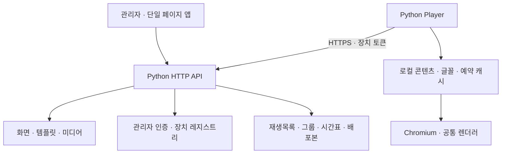

# 구조 안내

[← README](../README.md) · [개발 안내](../DEVELOPMENT.md) · [Player 연결](../DEVICE_REGISTRATION.md)

## 구성 요소

### Server

`server.py`가 관리자 화면, 콘텐츠, 미디어, 인증을 제공합니다. 장치 요청은 `device_api.py`, 그룹 운영은 `operations_api.py`로 나뉩니다. 저장은 JSON 파일과 원자적 파일 교체를 사용하며 **데이터 세트당 단일 서버 프로세스**를 전제로 합니다.

### Admin

`admin.js`는 해시 경로 기반 단일 페이지 앱입니다. 탭을 전환할 때 문서를 다시 불러오지 않습니다. 편집 중인 초안은 브라우저 메모리에 보관하고, 저장한 콘텐츠는 서버에 기록합니다.

### Player

`device_client.py`가 서버 확인·토큰 인증·재연결·다운로드를 담당합니다. Chromium은 로컬 캐시를 출력합니다. 관리 서버를 각 Player에서 실행하지 않습니다.

`canvas.js`는 관리자 미리보기와 Player가 공유하는 렌더러입니다. `scheduled-player.js`는 캐시된 시간표에 따라 재생목록과 분할 영역을 선택합니다.

## 인증 경계

| 요청 | 인증 방식 |
| --- | --- |
| 관리자 조회 | 관리자 세션 쿠키 |
| 관리자 변경 | 세션 쿠키 + CSRF 토큰 |
| 최초 연결 요청 | Player 비공개 난수 + 관리자 코드 연결 |
| 등록 장치 연결 | 장치별 토큰 |
| 장치 미디어·글꼴 | 배정 범위를 확인하는 서명 URL |

관리자 비밀번호는 무작위 솔트와 PBKDF2 해시로 저장합니다. Player의 고정 코드는 연결 입력용이며 UUID를 대체하지 않습니다. 서버 검색 결과만으로 서버를 신뢰하지 않고 HTTPS 인증서와 저장된 서버 ID를 함께 확인합니다.

## 초안과 배포본

1. 출력 화면에서 콘텐츠를 만듭니다.
2. 재생목록에 콘텐츠 순서와 표시 시간을 지정합니다.
3. 그룹에 장치·기본 목록·시간표·분할 구성을 지정합니다.
4. 배포 시 해당 구성과 콘텐츠를 복제해 송출본을 생성합니다.
5. Player가 송출본을 내려받고 수신 버전을 보고합니다.

배포 후 원본을 수정해도 송출본은 유지됩니다. 배포본이 참조하는 미디어·글꼴은 삭제할 수 없습니다. 운영 기록의 **수신**은 다운로드된 버전을 뜻하며 TV 전원이나 실제 화면 표시를 증명하는 값은 아닙니다.

## 로컬 저장

| 저장소 | 주요 내용 |
| --- | --- |
| `.json` | 화면·설정·내 템플릿 |
| `.auth.json` | 관리자 해시·서명 키 |
| `.devices.json` | 서버 UUID·장치 인증·배정·상태 |
| `.operations.json` | 재생목록·그룹·배포본·최근 활동 |
| `.media/` · `.fonts/` | 업로드 파일 |
| Player 상태 폴더 | UUID·코드·토큰·신뢰 설정·캐시 |

위 이름은 `--data`로 지정한 파일 이름에 대응합니다. 초기 실행은 빈 데이터와 새 서버 식별정보를 생성하며 공용 계정이나 고정 비밀키를 포함하지 않습니다.

## 범위와 제약

- 최대 6개의 독립 분할 영역과 일반 재생목록을 지원합니다.
- 예약·임시 출력은 Player의 로컬 시각을 기준으로 선택할 수 있습니다.
- JSON 저장소는 여러 서버 인스턴스의 동시 쓰기를 지원하지 않습니다.
- 실장치 전원 제어·원격 캡처·원격 콘솔·OTA·스트리밍 변환·실제 재생 증명은 현재 구현 범위 밖입니다.
